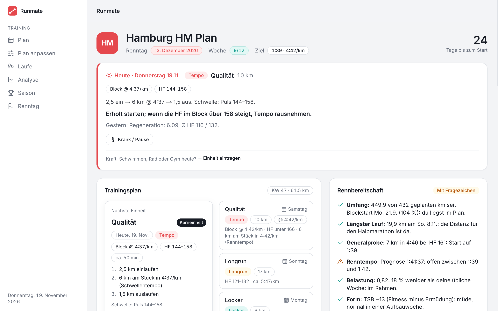
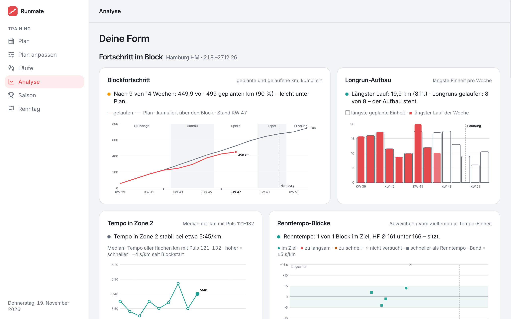
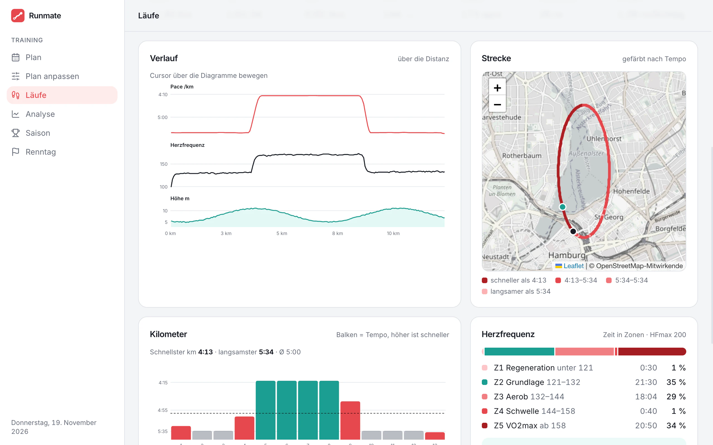
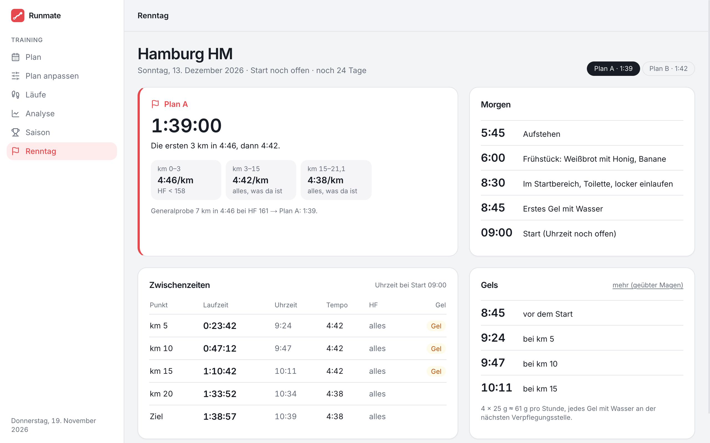
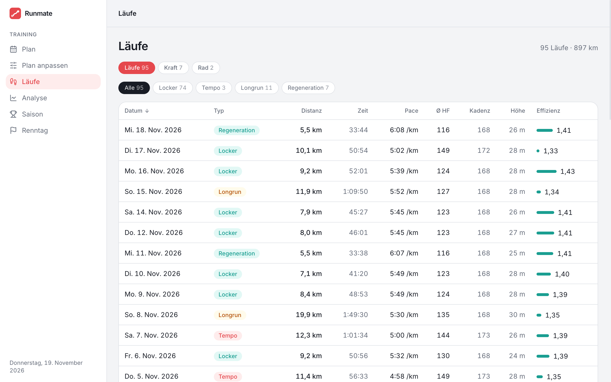

<div align="center">


# Runmate

**An adaptive marathon and half-marathon training plan that reads your real runs and adjusts itself,<br>built on published training methods.**

[](https://github.com/livius33/runmate/actions/workflows/ci.yml)
[](LICENSE)
[](docs/SELF-HOST.md)

[Website](https://runmate.dev) · [Features](#features) · [Screenshots](#screenshots) · [Quick start](#quick-start) · [Data sources](#data-sources) · [Contributing](CONTRIBUTING.md)



</div>

## Why Runmate

Most training plans are a fixed PDF, and most adaptive ones are a black box. Runmate starts from a published method
(Daniels, Pfitzinger, Hansons and others), syncs the runs you actually did, and adjusts the plan when life gets in the
way, telling you **why** each session changed and letting you undo it. It is open source and runs on your own server,
so your training and health data stay yours.

> **Early release.** Runmate works today for several users per instance (Garmin, Apple Health and file import). A
> hosted version is coming at **[runmate.dev](https://runmate.dev)**. The interface is in **German** for now;
> code and docs are English.

## Features

- **Plans from methods, not from scratch.** Generate a block for a goal race from methodology templates (Daniels,
  Pfitzinger, Hansons, Lydiard, Norwegian threshold, polarized 80/20) or your own method, with the reasons for every
  number. Templates are plain Markdown + YAML in [`methodologies/`](methodologies/); the research behind the rules is in
  [`methodologies/research/`](methodologies/research/).
- **Adaptive engine.** Missed key sessions move, missed kilometres are rebalanced within safe caps, a fatigue guard
  softens sessions when TSB or ACWR enter the red zone, and every change is explained and can be undone.
- **Real-life planning.** Sick/pause periods with a graded return, minor races inside a block (test, build or just for
  fun), a rolling base block between goal races, a season timeline.
- **Run analysis.** Pace, heart rate, elevation and cadence over the run, splits, HR zones, a map, comparison with
  similar runs, per-run insights and feedback (RPE, feel, pain).
- **Fitness & load.** CTL/ATL/TSB (TRIMP), ACWR, cross-training load by session-RPE, progress per block.
- **Race week and race day.** Race-week checklist, carb amounts, pacing plan A/B with checkpoints and gel timing,
  post-race analysis against the plan.
- **Calendar and Apple Health.** A private ICS feed of the plan; an iOS Shortcut posts daily Health data (sleep,
  resting HR, HRV, weight, other workouts).

## Screenshots

A fictional demo runner, eight weeks into a half-marathon block (generated data, no real person).

| Analysis | A single run |
|:---:|:---:|
|  |  |
| **Race day** | **All runs** |
|  |  |

## Quick start

You need Docker and a free [Clerk](https://clerk.com) application for sign-in.

```bash
git clone https://github.com/livius33/runmate.git && cd runmate
cp .env.example .env              # Clerk keys, POSTGRES_PASSWORD, ENCRYPTION_KEY, CRON_SECRET
docker compose up -d --build      # Postgres + migrations + app on http://localhost:3000 + daily sync
```

Sign in and follow the onboarding: your profile (max and resting heart rate, time zone, …), a data source, and a goal
race with its first plan. Self-hosting has every feature switched on; there is nothing to pay for.

- **[docs/SELF-HOST.md](docs/SELF-HOST.md)**: Docker Compose or Neon + Vercel, updates, backups, troubleshooting.
- **[docs/HOSTING.md](docs/HOSTING.md)**: every environment variable, database migrations, and running a multi-user
  or demo instance.

## Data sources

| Source | Status |
|---|---|
| **Garmin** (login) | Works, experimental. Each user's own login, stored encrypted; unofficial, so Garmin can break it any time. No MFA |
| **Apple Health** | Works. An iOS Shortcut posts to your private link |
| **File import** (FIT, GPX, TCX, Garmin export ZIP) | Works. Duplicates across sources are detected and merged |
| Garmin official API | Planned |
| Strava | Planned |
| Polar, COROS, Suunto, Wahoo | Later |

You are responsible for using each source within its terms. Every source implements one interface,
`ActivitySource` ([`lib/sources/types.ts`](lib/sources/types.ts)); adding one means implementing it and listing it in
[`lib/sources/registry.ts`](lib/sources/registry.ts). Contributions welcome.

## Disclaimer

Runmate is **not a medical device** and gives no medical advice. Plans, insights and predictions are training
suggestions derived from published methods and your data; they do not diagnose anything or promise any health or
performance outcome. Stop and see a doctor when something hurts or feels wrong.

## Licence

Copyright © 2026 Livius de Graaf and contributors.

Runmate is free software under the [GNU Affero General Public License v3.0](LICENSE): you may use, change and share it,
and if you run a modified version as a network service, you must offer its source to its users. "Runmate" is a
trademark of the project; the licence does not grant rights to the name or logo. Contributions need a CLA, see
[CONTRIBUTING.md](CONTRIBUTING.md).
